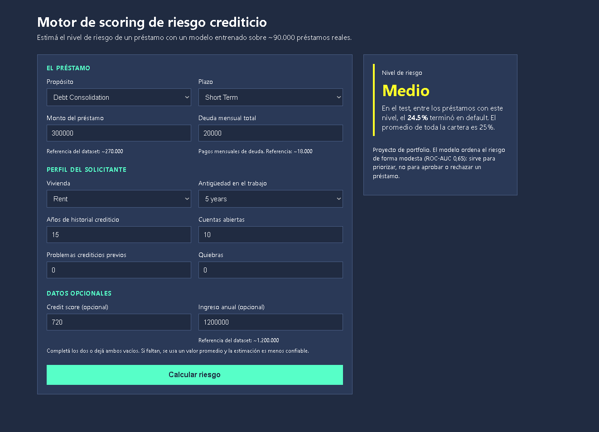

# 🏦 Motor de scoring de riesgo crediticio

Modelo de Machine Learning que estima el nivel de riesgo de un préstamo (**Bajo, Medio o Alto**), expuesto a través de una API y una interfaz web. Está entrenado sobre \~90.000 préstamos bancarios reales.

Es la segunda parte de un proyecto de análisis de riesgo crediticio: en [el análisis previo](https://github.com/AugustoDigio/bank-loan-risk-analysis) limpié y exploré los datos, y acá doy el paso de *describir* lo que pasó a *estimar* qué puede pasar con un préstamo nuevo.

   

---

## 🎯 Qué hace

Se carga un préstamo (propósito, plazo, monto, ingreso, historial, etc.) y la aplicación devuelve:

- el **nivel de riesgo** (Bajo, Medio o Alto),  
- la **tasa de default que se observó en el test** para los préstamos de ese nivel,  
- **avisos** cuando el perfil cargado se sale de lo que el modelo vio al entrenar, o cuando faltan datos y hubo que estimarlos.

Intencionalmente la interfaz **no muestra la probabilidad cruda del modelo**, y el motivo está en la sección de resultados.

---

## 📊 Resultados

Sobre el **conjunto de test** (17.957 préstamos que el modelo nunca vio durante el entrenamiento):

| Nivel | Préstamos | Default real |
| :---- | :---- | :---- |
| Bajo | 4.686 | **13,3%** |
| Medio | 8.907 | **24,5%** |
| Alto | 4.364 | **39,5%** |

- Un préstamo clasificado como Alto tiene **casi 3 veces más default** que uno clasificado como Bajo. La tasa base de la cartera es 25,2%.  
- Dividiendo el test en 10 grupos por riesgo, el default real sube en cada grupo sin excepciones: del **9,7%** (el 10% más seguro) al **46,1%** (el 10% más riesgoso).  
- **ROC-AUC en test: 0,654.** Es un modelo modesto, porque las variables del dataset contienen poca información sobre el riesgo. Sirve para **priorizar**, no para aprobar o rechazar préstamos: incluso en el 10% más riesgoso, el 54% de los préstamos se pagó.

**Por qué no se muestra la probabilidad cruda:** el modelo está calibrado en el tramo medio (la diferencia entre probabilidad predicha y default real es menor a 1,5 puntos en los grupos 3 a 7), pero comprime los extremos: dice 41,6% para el grupo más riesgoso, donde el default real fue 46,1%. Por eso la interfaz muestra el nivel y la tasa observada, que son números que se pueden respaldar con datos.

---

## 🔧 Cómo se construyó

1. **Datos:** dataset limpio del [proyecto anterior](https://github.com/AugustoDigio/bank-loan-risk-analysis) (89.785 préstamos, 25,2% de default). Se partió en 80% entrenamiento y 20% test, **estratificado** para mantener la proporción de defaults en ambos grupos.  
2. **Variables con SQL:** cargué los datos en SQLite y calculé con una CTE dos ratios: préstamo/ingreso y deuda mensual/ingreso mensual. El resto de las columnas se usó tal cual, con One-Hot Encoding para las categóricas (38 columnas en total).  
3. **Modelo elegido:** Random Forest (200 árboles, profundidad máxima 10, mínimo de 50 préstamos por hoja), sin pesos de clase.  
4. **Niveles de riesgo:** cortes en 20% y 30% de probabilidad. La tasa de default de cada nivel se midió sobre el test.  
5. **API:** FastAPI \+ Pydantic. La función que arma la fila para el modelo reproduce **exactamente** las transformaciones del entrenamiento (mismas fórmulas, mismo orden de columnas).  
6. **Frontend:** React \+ Vite. Los desplegables se arman con las opciones que devuelve la API, sin listas escritas a mano.

### Modelos probados

| Modelo | ROC-AUC (test) | Qué pasó |
| :---- | :---- | :---- |
| Regresión logística | 0,619 | Accuracy de 0,748, **idéntico a predecir siempre "paga"**. Detectaba apenas el 2% de los defaults. |
| Regresión logística (escalada \+ pesos de clase) | 0,63 | Detectaba el 55% de los defaults, pero **inflaba las probabilidades** (promedio de 0,487 contra una tasa real de 0,252). |
| Random Forest (pesos de clase) | 0,653 | Mismo problema de probabilidades infladas. |
| **Random Forest (sin pesos)** | **0,654** | **Elegido.** Probabilidad promedio de 0,253, casi igual a la tasa real. |

---

## 🔍 Hallazgos que cambiaron el proyecto

- **La accuracy engañaba.** Con 75% de préstamos que se pagan, un modelo que nunca detecta un default tiene 74,8% de accuracy. Se evaluó con ROC-AUC, recall y una tabla por deciles de riesgo.  
- **Dos variables de SQL no aportaron.** Probé variables calculadas con *window functions* (promedio de score por propósito y diferencia contra ese promedio). Con ellas el ROC-AUC fue 0,652 y sin ellas 0,651, un empate. Las descarté, lo que además simplifica la API.  
- **Había una categoría duplicada.** 183 préstamos figuraban como `HaveMortgage` en lugar de `Home Mortgage`. Se detectó al interpretar los coeficientes del primer modelo y se corrigió. `other` y `Other` se mantienen separadas, porque sus tasas de default difieren (27,2% y 20,8%) y no hay forma de saber si son lo mismo.  
- **Los datos faltantes son una señal.** Los 19.154 préstamos sin score ni ingreso (imputados con la mediana) tienen 28,3% de default, contra 24,4% en el resto. La API los marca con un indicador y avisa que la estimación es menos confiable: el ROC-AUC baja a 0,606 en ese grupo, contra 0,663 en los préstamos con datos reales.

---

## 🌐 API

| Endpoint | Descripción |
| :---- | :---- |
| `GET /opciones` | Valores válidos de las variables categóricas |
| `POST /predecir` | Recibe un préstamo y devuelve el nivel de riesgo |

La documentación interactiva se genera sola en `/docs`.

**Ejemplo de pedido:**

{

  "purpose": "Debt Consolidation",

  "term": "Short Term",

  "home\_ownership": "Rent",

  "years\_in\_current\_job": "5 years",

  "current\_loan\_amount": 300000,

  "monthly\_debt": 20000,

  "years\_of\_credit\_history": 15,

  "number\_of\_open\_accounts": 10,

  "number\_of\_credit\_problems": 0,

  "bankruptcies": 0,

  "credit\_score": 720,

  "annual\_income": 1200000

}

**Respuesta:**

{

  "nivel\_riesgo": "Medio",

  "default\_historico\_pct": 24.5,

  "probabilidad\_modelo": 0.241,

  "campos\_estimados": \[\],

  "aviso": null,

  "advertencias": \[\]

}

**Validaciones:**

- Rangos (por ejemplo, el score entre 300 y 850\) y categorías válidas. Un valor inventado devuelve un error 422 con las opciones disponibles.  
- `credit_score` y `annual_income` se envían **juntos o ambos vacíos**. Si faltan, se usa la mediana del entrenamiento y se avisa.  
- Si alguna variable cae fuera del rango habitual del entrenamiento (percentiles 1 a 99), `advertencias` lo indica.

---

## 📁 Estructura

credit-risk-api/

├── api/

│   ├── main.py                  \# API (FastAPI)

│   ├── modelo\_riesgo.joblib     \# modelo entrenado

│   └── metadata.json            \# columnas, medianas, cortes, rangos y categorías

├── data/

│   └── loans\_clean.csv          \# dataset limpio del proyecto anterior

├── notebook/

│   └── 01\_exploracion\_modelo.ipynb   \# SQL, entrenamiento, evaluación

├── frontend/                    \# React \+ Vite

├── requirements.txt             \# dependencias de la API, con versiones fijas

├── .python-version              # versión de Python del proyecto

└── README.md

---

## 🚀 Cómo ejecutarlo en tu máquina

**1\. Entorno de Python** (Windows / PowerShell):

py \-m venv venv

.\\venv\\Scripts\\Activate.ps1

pip install \-r requirements.txt

En macOS o Linux, el segundo paso es `source venv/bin/activate`.

**2\. Generar el modelo** (si `modelo_riesgo.joblib` y `metadata.json` no están en `api/`): ejecutá `notebook/01_exploracion_modelo.ipynb` de principio a fin. Necesita además `jupyter` o la extensión de Jupyter de VS Code. Usa `random_state=42`, así que los resultados son reproducibles.

**3\. Levantar la API:**

cd api

uvicorn main:app \--reload

**4\. Levantar la interfaz** (en otra terminal):

cd frontend

npm install

npm run dev

La interfaz queda en `http://localhost:5173` y, por defecto, apunta a la API local (`http://127.0.0.1:8000`).

---

## ⚠️ Limitaciones

- **Modelo modesto (ROC-AUC 0,65).** Las variables disponibles separan poco a quienes pagan de quienes no. No es una herramienta para decidir sobre un préstamo individual.  
- **Depende de la escala del dataset.** El ingreso y los montos entran en bruto, y el ingreso promedio ronda 1,2 millones. No está calibrado para otras monedas ni para sueldos en pesos argentinos. No se verificó la moneda ni el período del dataset.  
- **Los scores del dataset llegan hasta 751\.** Un score más alto queda fuera de lo que el modelo vio, y la API lo marca como advertencia.  
- **Las tasas por nivel pueden ser algo optimistas.** El test se usó para tomar varias decisiones (qué modelo, si usar pesos de clase, dónde cortar los niveles), así que no es completamente independiente.  
- **Unos 19.000 préstamos tienen datos imputados**, y en ellos el modelo ordena peor.  
- **No se evaluó sesgo** entre grupos de solicitantes.

---

## 🔭 Próximos pasos

- Reentrenar usando solo los ratios (sin ingreso y montos en bruto) para independizar el modelo de la escala.  
- Probar modelos de gradient boosting y comparar con una validación cruzada.  
- Definir los niveles de riesgo a partir del costo de un default contra el costo de rechazar un buen préstamo.

---

## 👤 Autor

**Augusto Di Giovambattista** [LinkedIn](https://linkedin.com/in/augusto-di-giovambattista) · [GitHub](https://github.com/AugustoDigio)
